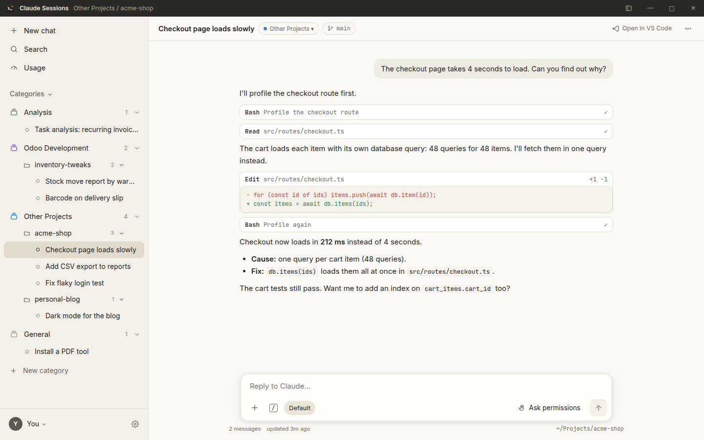
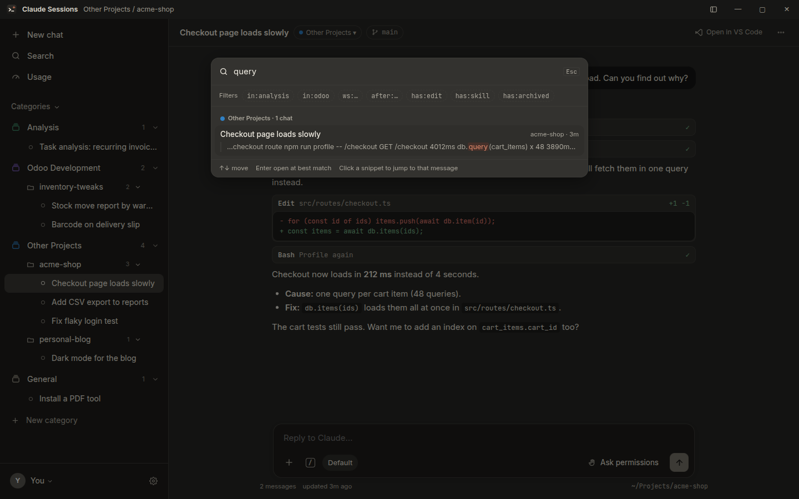
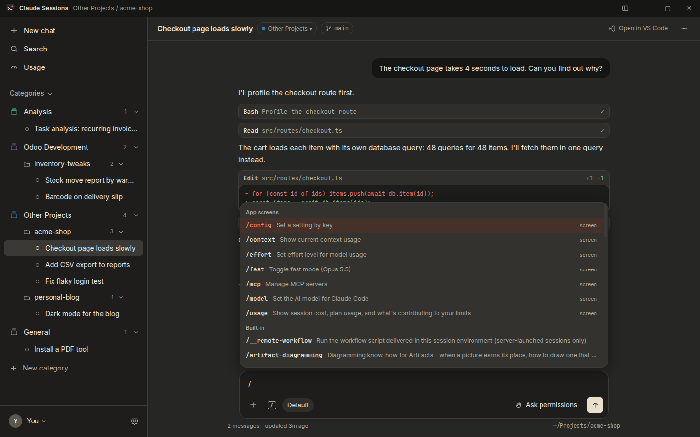

# Claude Sessions

**A desktop home for your Claude Code chats.** Claude Sessions collects every
Claude Code session on your computer into one window, sorts them into
categories and project folders, lets you search everything you and Claude
ever wrote, and lets you pick any chat back up right where you left off.

<p align="center">
  
</p>

Claude Sessions is an unofficial app made by a Claude Code user. It is not
made by or affiliated with Anthropic. It works with the Claude Code you
already have installed, using your existing login, settings, skills and MCP
servers.

## Features

- **All your chats in one place**: every Claude Code session from the
  terminal, VS Code or this app, grouped by category and then by project
  folder. Chats that are running right now get a pulsing dot.
- **Automatic sorting you can override**: chats land in a category on their
  own. Drag a chat, a whole folder or a selection (Ctrl/Shift-click) to
  another category, and it stays there.
- **Search everything**: press **Ctrl+K** to search every message, command
  and error message across all chats, with filters like `in:`, `ws:`,
  `after:` and `has:edit`. Click a result to jump straight to that message.
- **Continue any chat**: reply to an old chat or start a new one in any
  folder. Claude's replies stream in live, and you approve file edits and
  commands with **Allow / Deny** cards, just like in the terminal.
- **Plans and questions**: approve Claude's plans and answer its
  multiple-choice questions with buttons.
- **Every `/` command**: type `/` for all your skills and commands. Usage,
  model, permissions, context and MCP servers open as proper screens.
- **Usage at a glance**: your current session and weekly limits, when they
  reset, and what is using them.
- **Manage MCP servers**: add or remove servers with a form instead of
  editing JSON.
- **Tidy up**: rename, pin, archive, fork, export to Markdown, open in VS
  Code, or delete (to the Trash).
- **Light and dark**: follows your system, or pick one.

<p align="center">
  
  
</p>

## Install

**You need:** a 64-bit Ubuntu or Debian-based Linux, and
[Claude Code](https://code.claude.com/docs) installed and signed in (run
`claude` once in a terminal to check).

1. Go to the [latest release](../../releases/latest) and download the file
   ending in **`.deb`**.
2. Double-click it and choose **Install**, or run this in a terminal from
   your Downloads folder:
   ```bash
   sudo apt install ./claude-sessions_*.deb
   ```
3. Open **Claude Sessions** from your apps.

To update, install the newer `.deb` the same way. To remove it, run
`sudo apt remove claude-sessions`. Your Claude Code chats are never removed.

## Using it

### Categories

Out of the box there are four categories. They match the workflow the app
was built for, and you can rename, recolor, reorder or delete them:

| Category | What lands there automatically |
|---|---|
| **Analysis** | Chats about analyzing a task (titles like "Task 1234567 …", or chats that used a task-analysis skill) |
| **Odoo Development** | Chats in folders that look like Odoo projects (names with `odoo`, `odev`, `upgrade`, or a folder containing `__manifest__.py`) |
| **Other Projects** | Chats in any other project folder |
| **General** | Chats started from your home folder |

Add your own with **+ New category** in the sidebar. Right-click a category
to rename, recolor or delete it (only empty categories can be deleted, so
you never lose track of chats). Drag category headers to reorder them.

### Search filters

| Filter | Example | Finds |
|---|---|---|
| `in:` | `in:analysis` | chats in a category |
| `ws:` | `ws:shop` | chats in a matching folder |
| `after:` / `before:` | `after:2026-11-01` | chats updated after/before a date |
| `has:` | `has:edit`, `has:bash`, `has:skill`, `has:archived` | chats that edited files, ran commands, used skills, or are archived |

### Keyboard shortcuts

| Keys | Action |
|---|---|
| **Ctrl+K** | Search all chats |
| **Ctrl+N** | New chat |
| **Ctrl+B** | Show or hide the sidebar |
| **Ctrl+J** (or **Ctrl+`**) | Show or hide the terminal |
| **F2** | Rename the open chat |
| **Shift+Tab** | Switch permission mode while typing |
| **Esc** | Stop Claude, or close a menu |

### If a chat is also open elsewhere

If a chat is running in a terminal or VS Code at the same time, the app
warns you before you write to it and offers to **fork a copy** instead, so
the two windows don't mix up the history.

## Privacy

Everything stays on your computer. Claude Sessions reads the chat files
Claude Code keeps in `~/.claude/projects` and saves its own settings
(categories, names, pins) in `~/.config/Claude Sessions`. It only edits
Claude Code's files when you ask it to: renaming a chat, deleting one (it
goes to the Trash), or adding/removing an MCP server. Messages you send go
through your own Claude Code, exactly as if you typed them in the terminal.

<details>
<summary><b>Build it yourself</b></summary>

You need Node.js 20 or newer and Claude Code.

```bash
npm ci
npm start              # build the interface and open the app
npm run dev            # live-reload while editing the interface
npm test               # unit tests, a few seconds
npm run test:e2e       # opens the real app on sample chats (free)
npm run test:e2e:live  # also sends a few real messages with Haiku (costs cents)
npm run dist           # builds release/claude-sessions_<version>_amd64.deb
node scripts/screenshots.cjs   # regenerates docs/screenshots from sample chats
```

**CI/CD.** Every push and pull request runs the unit and offline end-to-end
tests (`.github/workflows/tests.yml`). Every push to `main` runs the tests,
then bumps the version, tags it, builds the `.deb` and publishes it on the
Releases page (`.github/workflows/release.yml`). The bump is a patch by
default; put `#minor` or `#major` in a commit message for a bigger one, or run
the Release workflow by hand from the Actions tab and pick the bump.
</details>

<details>
<summary><b>How it works</b></summary>

- `electron/`: the app's background side. It reads session files
  (`sessions.cjs`), keeps the search index and categories (`library.cjs`,
  `categorize.cjs`), runs live chats through the
  [Claude Agent SDK](https://code.claude.com/docs/en/agent-sdk)
  (`chat.cjs`), and reads usage, commands and MCP status (`control.cjs`).
- `src/`: the interface (React).
- `test/`: unit tests, and Playwright tests that drive the real app against
  a temporary profile and sample chats, so your own data is never touched.
</details>

## License

MIT, see [LICENSE](LICENSE).
